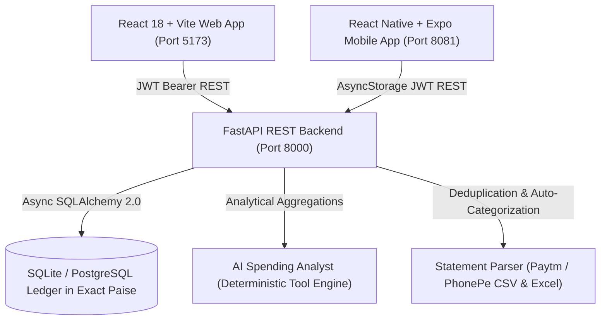

# SmartSpend AI 🪙

> **Modern Personal Finance Management Assistant for India**
> Deterministic Analytics • UPI & Statement Reconciliation • Exact-Paise Ledger • AI Spending Analyst

---

## 🌟 Executive Summary

**SmartSpend AI** is a production-grade personal finance management application engineered specifically for the Indian financial ecosystem. Unlike basic expense trackers that use approximate floating-point calculations or unofficial scraping, SmartSpend AI provides:

1. **Deterministic Financial Ledger**: All monetary values are strictly stored and computed as **exact integer minor units (Paise)**, eliminating floating-point rounding drift.
2. **Indian Ecosystem Native**: Built-in support for INR (`₹`), Indian numbering comma grouping (`₹1,23,456.78`), Indian date formatting (`DD/MM/YYYY`), IST timezone (`Asia/Kolkata`), and UPI transaction methods (**PhonePe**, **Paytm**, **GPay**, **CRED**, **BHIM**).
3. **Authorized Statement Reconciliation**: Pure-Python statement parser for exported Paytm, PhonePe, and Bank CSV/Excel records with automated duplicate detection (SHA-256 fingerprinting) and rule-based categorization.
4. **Zero Credential / PIN Storage**: Fully compliant with RBI, NPCI, and DPDP Act 2023 principles. SmartSpend AI **never** asks for, stores, or transmits Bank passwords, UPI MPINs, or OTPs.
5. **Deterministic AI Spending Analyst**: An AI assistant backed by verifiable SQL analytics tools (top categories, wastage detection, budget run-rates) that gives grounded advice rather than hallucinated amounts.
6. **Smart Budgets & Savings Goals**: Real-time threshold alerts (50%, 75%, 90%, 100%), run-rate End-of-Month (EOM) spending projections, and visual savings target trackers.
7. **Recurring Subscriptions Tracker**: Active tracking of Indian recurring services (Netflix, Spotify, Wifi, Gym) with annualized spending impact metrics ($12\times$, $52\times$).

---

## 🏗️ System Architecture



### Core Technology Stack

- **Backend:** Python 3.14, FastAPI, SQLAlchemy 2.0 (Async), SQLite/PostgreSQL, Pydantic v2, Python-Jose (JWT), Bcrypt, OpenPyXL.
- **Web Frontend:** React 18, TypeScript, Vite, Tailwind CSS, Recharts, Lucide Icons, Axios.
- **Mobile Application:** React Native, Expo SDK 52, TypeScript, Safe Area Context, Async-Storage, Lucide React Native, Axios.
- **Security:** Multi-tenant row-level tenant isolation, SHA-256 idempotency hashing, Bcrypt password hashing.

---

## 🚀 Quick Start Guide

### 1. Prerequisites
- **Python 3.11+** installed
- **Node.js 20+** installed
- *(Optional for Mobile)*: Expo Go on your Android/iOS device or Android Studio emulator

### 2. Backend Setup
```bash
cd backend
python -m venv venv
# On Windows PowerShell:
.\venv\Scripts\activate
# On Linux / macOS:
source venv/bin/activate

pip install -r requirements.txt
python seed_demo_data.py
uvicorn app.main:app --port 8000 --reload
```
API running at **[http://127.0.0.1:8000](http://127.0.0.1:8000)** (Docs at `http://127.0.0.1:8000/docs`).

### 3. Web Frontend Setup
```bash
cd frontend
npm install
npm run dev
```
Open **[http://127.0.0.1:5173](http://127.0.0.1:5173)** in your browser.

### 4. Mobile Application Setup
```bash
cd mobile
npm install
npx expo start
```
Metro Bundler running on **[http://localhost:8081](http://localhost:8081)**. Scan the QR code using Expo Go or press `a` for Android Emulator / `w` for Web preview.

---

## 🔑 Demo Account Credentials

For instant testing with preloaded realistic Indian financial transactions:
- **Email:** `demo@smartspend.ai`
- **Password:** `Password123!`
- *(Or simply click the **"Instant Demo Login"** button on the sign-in screen)*

---

## 📊 Automated Verification & Test Suite

SmartSpend AI includes an automated test suite verifying all 6 core financial guarantees:
```bash
cd backend
python tests/run_tests.py
```

### Verified Guarantees:
1. **Paise Precision Math**: Ensures zero floating-point arithmetic drift on conversions.
2. **JWT Security & Auth**: Validates token generation, bearer protection, and payload validation.
3. **Transaction Deduplication**: Prevents duplicate entries via SHA-256 transaction fingerprinting.
4. **Transfer/Refund Isolation**: Verifies internal transfers and refunds do not inflate income/expense analytics.
5. **Multi-Tenant Data Isolation**: Confirms User B cannot access User A's accounts, budgets, or ledger records.
6. **AI Analyst Tool Grounding**: Confirms natural-language queries return exact, database-verified totals.

---

## 📜 REST API Documentation

When the backend server is running, interactive Swagger API documentation is available at:
- **Swagger UI:** [http://127.0.0.1:8000/docs](http://127.0.0.1:8000/docs)
- **ReDoc:** [http://127.0.0.1:8000/redoc](http://127.0.0.1:8000/redoc)
- **Health Check:** [http://127.0.0.1:8000/health](http://127.0.0.1:8000/health)

---

## 🛡️ Compliance & DPDP Act 2023
- **Explicit Consent:** Financial statements are uploaded exclusively on-demand by the user.
- **Purpose Limitation:** Statement data is parsed strictly for personal ledger reconciliation.
- **Zero Third-Party Data Selling:** All data remains private and isolated to the authenticated user.
