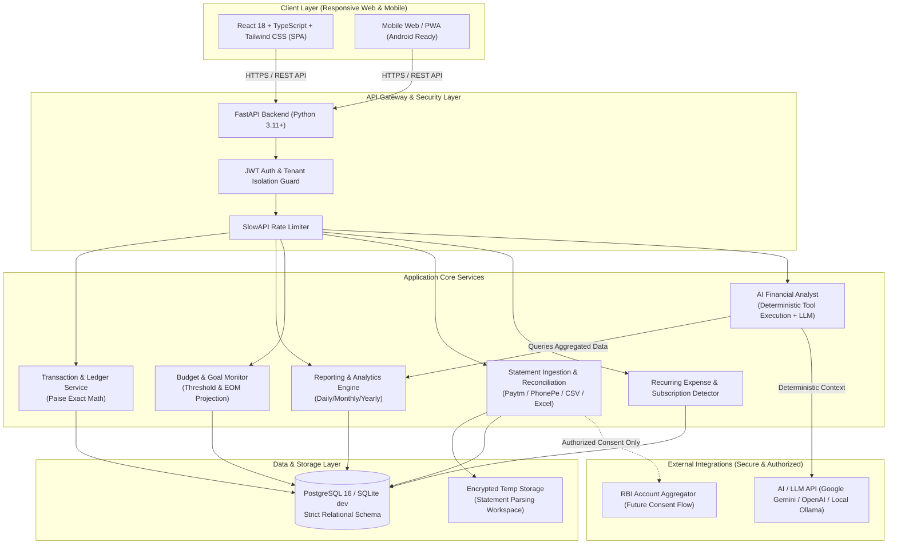
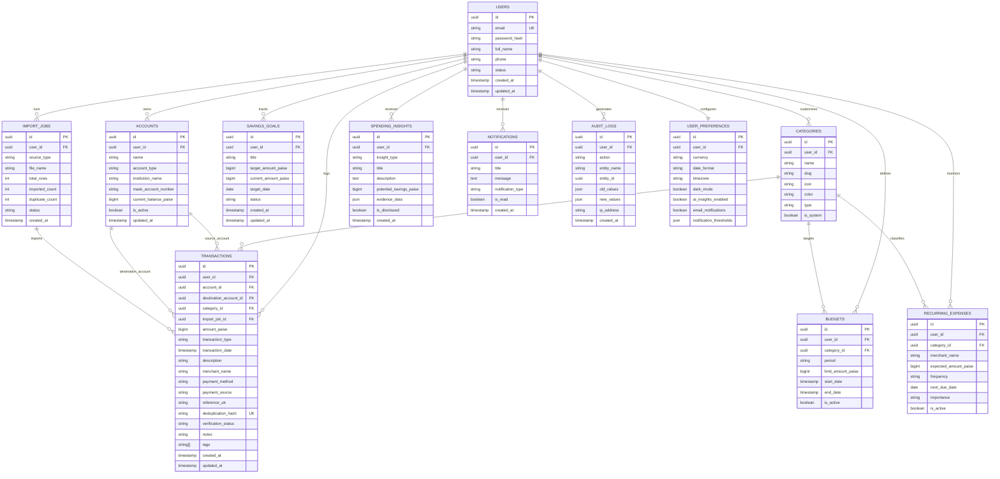
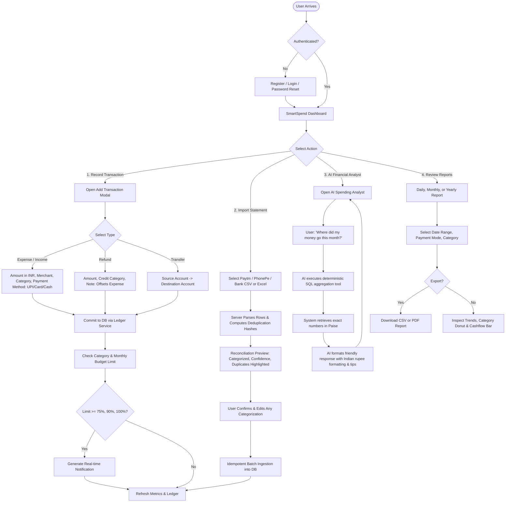
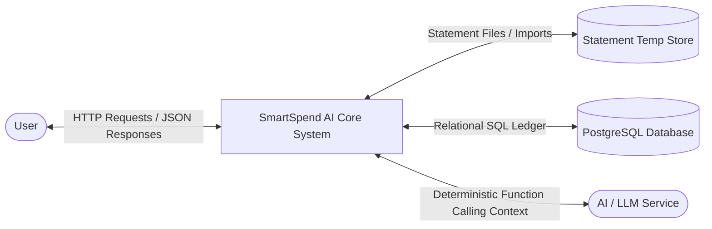
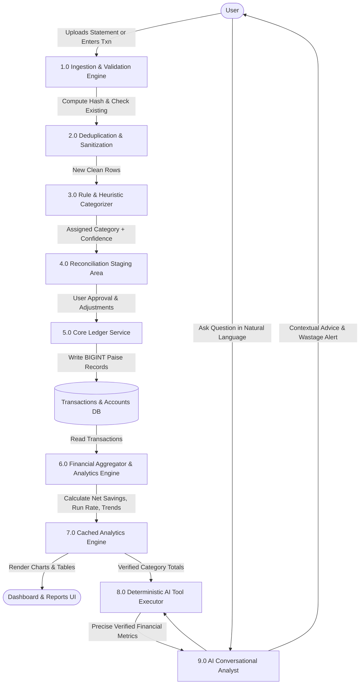

# SmartSpend AI — Comprehensive Architectural Blueprint & System Specification

**Version:** 1.0.0  
**Target Market:** India (INR ₹, UPI, Indian Date & Financial Calendar Formats)  
**Document Status:** Ready for Review & Implementation  

---

## 1. Project Overview

### 1.1 Executive Summary
**SmartSpend AI** is a modern, high-precision personal finance assistant designed specifically for Indian users (young professionals, students, freelancers, and families). Unlike generic budgeting apps that either manually track numbers without intelligence or unsafely demand banking passwords, SmartSpend AI combines:
1. **Deterministic Financial Precision:** All ledger math, balance rollups, budgets, and savings calculations are computed in exact integer minor units (paise) with zero floating-point inaccuracies.
2. **Indian Financial Ecosystem Alignment:** Native support for UPI transactions, UTR (Unique Transaction Reference) tracking, payment methods (Google Pay, PhonePe, Paytm, CRED, NetBanking, Cash), and India-specific expense categories (College fees, Books, Rent, Electricity, Groceries, Domestic help, Loan EMIs).
3. **Safe & Authorized Paytm / PhonePe Integration:** Strict adherence to RBI and NPCI guidelines through official statement ingestion (CSV, Excel, PDF), transaction reconciliation, and optional RBI Account Aggregator (AA) hooks—without ever storing PINs, OTPs, or login credentials.
4. **Deterministic AI Spending Analyst:** An AI assistant that uses verified SQL/analytical queries as tools rather than hallucinations, delivering actionable savings recommendations, wastage detection, and budgeting advice based on verified financial data.

### 1.2 Target Audience & Core Personas
* **Persona A: The Urban Young Professional (Aarav, 24):** Receives monthly salary via NEFT, executes 4–10 daily UPI payments (tea, Swiggy, Uber, grocery), frequently wonders where 40% of his discretionary income vanishes, and needs clear monthly categorization and automated wastage alerts.
* **Persona B: The College / B.Tech Student (Priya, 20):** Manages a strict monthly allowance of ₹10,000, needs daily spending limits, tracks semester book/exam expenses, and wants to save for a laptop.
* **Persona C: The Tech Freelancer / Consultant (Rohan, 29):** Irregular income streams, multiple bank accounts, recurring SaaS subscriptions, needs clear cash flow visibility, quarterly tax savings buffers, and automated recurring expense monitoring.

---

## 2. Functional Requirements

### 2.1 Authentication & Profile Management
* **FR-AUTH-01:** User registration with name, email, phone number (optional), and salted password hashing (Argon2id / bcrypt).
* **FR-AUTH-02:** Secure login issuing short-lived JWT access tokens (15–30 mins) and rotatable HTTP-only refresh tokens (7–30 days).
* **FR-AUTH-03:** Password reset flow with time-limited cryptographic tokens.
* **FR-AUTH-04:** Currency and locale settings (defaulting to `INR`, `en-IN`, `DD/MM/YYYY`, `Asia/Kolkata` timezone).
* **FR-AUTH-05:** Complete user data isolation: all transactional and profile data scoped strictly by `user_id`.
* **FR-AUTH-06:** Zero storage policy for payment PINs, UPI MPINs, card CVVs, OTPs, or bank netbanking passwords.

### 2.2 Transaction Engine & Ledger
* **FR-TXN-01:** Support 4 transaction types: `INCOME`, `EXPENSE`, `REFUND`, `TRANSFER`.
* **FR-TXN-02:** **Transfer Isolation:** Internal transfers between user accounts/wallets (e.g., Bank -> Paytm Wallet) do not alter Net Income or Net Expenses; they only adjust account balances.
* **FR-TXN-03:** **Refund Handling:** Refunds are tied to or credited against expense accounts, offsetting expense category totals without artificially inflating gross income.
* **FR-TXN-04:** Metadata support: Transaction date/time, amount in paise, category & subcategory, payment method (UPI, Card, NetBanking, Cash), merchant/payee name, UPI UTR / reference number, notes, tags, import source, verification status (`UNVERIFIED`, `VERIFIED`, `FLAGGED`).
* **FR-TXN-05:** Full CRUD operations: manual creation, inline editing, soft/hard deletion with confirmation, keyword search, multi-parameter filtering (date range, amount range, category, payment mode), and sorting.

### 2.3 Financial Reporting & Analytics Engine
* **FR-REP-01: Daily Report:** Daily income, daily expenditure, net daily cash flow, transaction count, largest transaction, remaining daily budget.
* **FR-REP-02: Monthly Report:** Total monthly income, total expenses, net savings ($Income - Expenses$), savings rate ($\frac{Savings}{Income} \times 100\%$), category breakdown, daily spending trendline, budget utilization, month-on-month variance.
* **FR-REP-03: Yearly Report:** Total annual income/expense, highest/lowest spending months, annual savings rate, cumulative progress toward savings goals.
* **FR-REP-04:** Export capability to standard CSV and printable PDF formats.

### 2.4 Paytm, PhonePe & Bank Ingestion Engine
* **FR-IMP-01:** File parser for standard statement exports:
  * Paytm Wallet & Bank Statement (CSV / Excel / PDF).
  * PhonePe Transaction Statement (CSV / PDF).
  * Standard Indian Bank CSV exports (HDFC, SBI, ICICI, Axis).
* **FR-IMP-02: Duplicate Detection:** Idempotent hash generation based on `hash(user_id, date, amount_paise, utr_or_ref, merchant_name)`. Existing records are flagged or skipped.
* **FR-IMP-03: Staging & Reconciliation:** Users preview parsed transactions with extracted categories and confidence scores before committing them to the live ledger.
* **FR-IMP-04: Account Aggregator Readiness:** Modular architecture to plug into RBI-regulated Account Aggregators (Setu, Anumati, Finvu) via standardized consent handles when API credentials are provided.

### 2.5 Smart Budgets & Savings Goals
* **FR-BUD-01:** Monthly overall and category-specific budgets (Food, Shopping, Transit, Entertainment, Utilities, Custom).
* **FR-BUD-02:** Real-time metrics: Spent amount, remaining budget, percentage consumed, days remaining in month, and projected end-of-month (EOM) spending based on run rate.
* **FR-BUD-03:** Alert thresholds at 50%, 75%, 90%, and 100% of budget limit.
* **FR-GOAL-01:** Goal tracker with goal title, target amount, current saved amount, target date, and required monthly contribution calculation. Goals do not claim to hold real custodial bank deposits.

### 2.6 Subscriptions & Recurring Expenses
* **FR-REC-01:** Pattern detection engine that identifies periodic charges (weekly, monthly, quarterly, annual) such as Netflix, Spotify, Hotstar, Jio/Airtel recharge, Gym, Rent, EMIs.
* **FR-REC-02:** Renewal reminders and annualized cost impact projection.

### 2.7 AI Spending Analyst & Wastage Detector
* **FR-AI-01: Deterministic Query Engine:** The AI natural-language assistant executes verified analytical SQL functions (e.g. `get_spending_by_category()`, `get_largest_expenses()`, `get_mom_comparison()`) rather than inventing numbers.
* **FR-AI-02: Anomaly & Wastage Detection:** Identifies repeated micro-discretionary spends, spikes in delivery fees, duplicate charges within short windows, and underutilized recurring subscriptions.
* **FR-AI-03: Actionable Recommendations:** Quantified, non-judgmental advice (e.g., *"Reducing weekend food delivery by ₹1,000/month accumulates ₹12,000 in your Emergency Fund over 12 months"*).

---

## 3. Non-Functional Requirements

| Dimension | Specification | Implementation Strategy |
| :--- | :--- | :--- |
| **Monetary Accuracy** | Zero floating-point rounding errors | Stored as `BIGINT` in Paise (1 INR = 100 Paise). Formatting applied only at presentation layer (`Intl.NumberFormat('en-IN')`). |
| **Performance** | API Response < 150ms (p95), Dashboard aggregation < 300ms | Indexed foreign keys, indexed composite fields `(user_id, transaction_date)`, pre-aggregated monthly summary caches if needed. |
| **Security & Privacy** | Compliance with Indian Digital Personal Data Protection (DPDP) Act 2023 | Zero storage of banking credentials/PINs. Encrypted at rest (AES-256 for statements/credentials), TLS 1.3 in transit. Row-level tenant isolation. |
| **Idempotency** | Prevent duplicate records from multiple imports or network retries | Unique deduplication hash index per user. API `Idempotency-Key` header support. |
| **Availability & Resilience**| 99.9% uptime target, Graceful AI degradation | Core transaction and reporting services operate autonomously even if external AI / LLM APIs are offline. |
| **Auditability** | Complete audit trail for sensitive changes | `audit_logs` table tracking transaction updates, deletions, and statement imports with timestamps and IP records. |
| **Localization** | Indian regional standards | Indian number grouping (`₹1,23,456.78`), `DD/MM/YYYY` date representation, and Asia/Kolkata (IST, UTC+05:30) timezone conversion. |

---

## 4. Feature Prioritization (MoSCoW Matrix)

```
┌────────────────────────────────────────────────────────────────────────┐
│                        FEATURE PRIORITIZATION                         │
├───────────────────────────────────┬────────────────────────────────────┤
│ MUST HAVE (MVP v1.0)              │ SHOULD HAVE (v1.1)                 │
│ • Secure JWT Auth & Isolation     │ • Advanced Wastage Detection       │
│ • Manual Transaction CRUD         │ • PDF Statement Ingestion          │
│ • Paise-precise Ledger Engine     │ • Natural Language AI Chat Assistant│
│ • Income/Expense/Transfer/Refund  │ • Recurring Subscriptions Detector │
│ • Interactive Dashboard & Reports │ • CSV/PDF Report Downloads         │
│ • Category & Overall Budgets      │ • Email & Web Push Notifications   │
│ • Savings Goals & Progress        │                                    │
│ • Paytm & PhonePe CSV Parser      │                                    │
│ • Deduplication Engine            │                                    │
├───────────────────────────────────┼────────────────────────────────────┤
│ COULD HAVE (v1.2)                 │ WON'T HAVE (v1.0 Out of Scope)     │
│ • Android Notification/SMS Ingest │ • Real-time bank fund transfers    │
│ • Multi-currency conversion       │ • Automated credit card bill pay   │
│ • RBI Account Aggregator OAuth    │ • Unofficial scraping / PIN hacks  │
│ • Voice-based conversational input│ • Direct stock brokerage trading   │
└───────────────────────────────────┴────────────────────────────────────┘
```

---

## 5. System Architecture Diagram



---

## 6. Database ER Diagram



---

## 7. User Flow Diagram



---

## 8. Data Flow Diagrams

### 8.1 DFD Level 0 (Context Level)


### 8.2 DFD Level 1 (Detailed Ingestion & Analytics Pipeline)


---

## 9. Complete Production Database Schema (PostgreSQL DDL)

All monetary columns use `BIGINT` representing **Paise** (1 INR = 100 Paise). Floating-point data types are strictly prohibited in the financial domain.

```sql
-- SmartSpend AI Production PostgreSQL Schema
-- Version: 1.0.0
-- Charset: UTF8, Timezone: UTC

CREATE EXTENSION IF NOT EXISTS "uuid-ossp";

-- 1. USERS TABLE
CREATE TABLE users (
    id UUID PRIMARY KEY DEFAULT uuid_generate_v4(),
    email VARCHAR(255) NOT NULL UNIQUE,
    password_hash VARCHAR(255) NOT NULL,
    full_name VARCHAR(120) NOT NULL,
    phone VARCHAR(20),
    is_active BOOLEAN NOT NULL DEFAULT TRUE,
    is_verified BOOLEAN NOT NULL DEFAULT FALSE,
    created_at TIMESTAMPTZ NOT NULL DEFAULT CURRENT_TIMESTAMP,
    updated_at TIMESTAMPTZ NOT NULL DEFAULT CURRENT_TIMESTAMP
);

CREATE INDEX idx_users_email ON users(email);

-- 2. USER PREFERENCES TABLE
CREATE TABLE user_preferences (
    id UUID PRIMARY KEY DEFAULT uuid_generate_v4(),
    user_id UUID NOT NULL UNIQUE REFERENCES users(id) ON DELETE CASCADE,
    currency VARCHAR(10) NOT NULL DEFAULT 'INR',
    date_format VARCHAR(20) NOT NULL DEFAULT 'DD/MM/YYYY',
    timezone VARCHAR(50) NOT NULL DEFAULT 'Asia/Kolkata',
    theme VARCHAR(20) NOT NULL DEFAULT 'system',
    ai_insights_enabled BOOLEAN NOT NULL DEFAULT TRUE,
    email_notifications BOOLEAN NOT NULL DEFAULT TRUE,
    threshold_alerts JSONB NOT NULL DEFAULT '[50, 75, 90, 100]'::jsonb,
    created_at TIMESTAMPTZ NOT NULL DEFAULT CURRENT_TIMESTAMP,
    updated_at TIMESTAMPTZ NOT NULL DEFAULT CURRENT_TIMESTAMP
);

-- 3. ACCOUNTS TABLE (Wallets, Bank Accounts, Cash)
CREATE TABLE accounts (
    id UUID PRIMARY KEY DEFAULT uuid_generate_v4(),
    user_id UUID NOT NULL REFERENCES users(id) ON DELETE CASCADE,
    name VARCHAR(100) NOT NULL, -- e.g. 'Paytm Wallet', 'HDFC Salary Account', 'Cash in Hand'
    account_type VARCHAR(30) NOT NULL, -- 'BANK', 'WALLET', 'CREDIT_CARD', 'CASH'
    institution_name VARCHAR(100), -- 'Paytm', 'PhonePe/YesBank', 'HDFC Bank', 'State Bank of India'
    mask_account_number VARCHAR(10), -- e.g. 'XX4912'
    current_balance_paise BIGINT NOT NULL DEFAULT 0,
    is_active BOOLEAN NOT NULL DEFAULT TRUE,
    created_at TIMESTAMPTZ NOT NULL DEFAULT CURRENT_TIMESTAMP,
    updated_at TIMESTAMPTZ NOT NULL DEFAULT CURRENT_TIMESTAMP
);

CREATE INDEX idx_accounts_user_id ON accounts(user_id);

-- 4. CATEGORIES TABLE
CREATE TABLE categories (
    id UUID PRIMARY KEY DEFAULT uuid_generate_v4(),
    user_id UUID REFERENCES users(id) ON DELETE CASCADE, -- NULL indicates global system default
    name VARCHAR(80) NOT NULL,
    slug VARCHAR(80) NOT NULL,
    icon VARCHAR(50) NOT NULL DEFAULT 'tag',
    color VARCHAR(20) NOT NULL DEFAULT '#6366F1',
    category_type VARCHAR(20) NOT NULL CHECK (category_type IN ('EXPENSE', 'INCOME', 'BOTH')),
    is_system BOOLEAN NOT NULL DEFAULT FALSE,
    created_at TIMESTAMPTZ NOT NULL DEFAULT CURRENT_TIMESTAMP
);

CREATE UNIQUE INDEX idx_categories_user_slug ON categories(COALESCE(user_id, '00000000-0000-0000-0000-000000000000'::uuid), slug);

-- 5. IMPORT JOBS TABLE
CREATE TABLE import_jobs (
    id UUID PRIMARY KEY DEFAULT uuid_generate_v4(),
    user_id UUID NOT NULL REFERENCES users(id) ON DELETE CASCADE,
    source_type VARCHAR(50) NOT NULL, -- 'PAYTM_CSV', 'PHONEPE_CSV', 'GENERIC_BANK_CSV', 'MANUAL'
    file_name VARCHAR(255),
    total_records INT NOT NULL DEFAULT 0,
    imported_records INT NOT NULL DEFAULT 0,
    duplicate_records INT NOT NULL DEFAULT 0,
    status VARCHAR(30) NOT NULL DEFAULT 'COMPLETED', -- 'PENDING', 'PROCESSING', 'COMPLETED', 'FAILED'
    error_message TEXT,
    created_at TIMESTAMPTZ NOT NULL DEFAULT CURRENT_TIMESTAMP
);

-- 6. TRANSACTIONS TABLE
CREATE TABLE transactions (
    id UUID PRIMARY KEY DEFAULT uuid_generate_v4(),
    user_id UUID NOT NULL REFERENCES users(id) ON DELETE CASCADE,
    account_id UUID REFERENCES accounts(id) ON DELETE SET NULL,
    destination_account_id UUID REFERENCES accounts(id) ON DELETE SET NULL, -- Used only when transaction_type = 'TRANSFER'
    category_id UUID REFERENCES categories(id) ON DELETE SET NULL,
    import_job_id UUID REFERENCES import_jobs(id) ON DELETE SET NULL,
    
    amount_paise BIGINT NOT NULL CHECK (amount_paise > 0),
    transaction_type VARCHAR(20) NOT NULL CHECK (transaction_type IN ('INCOME', 'EXPENSE', 'REFUND', 'TRANSFER')),
    transaction_date TIMESTAMPTZ NOT NULL,
    
    description VARCHAR(500) NOT NULL,
    merchant_name VARCHAR(150),
    payment_method VARCHAR(50) NOT NULL DEFAULT 'UPI', -- 'UPI', 'CREDIT_CARD', 'DEBIT_CARD', 'NETBANKING', 'CASH'
    payment_source VARCHAR(50), -- 'PAYTM', 'PHONEPE', 'GPAY', 'CRED', 'BHIM', 'DIRECT'
    reference_utr VARCHAR(100), -- UPI Ref / UTR / Order ID
    
    deduplication_hash VARCHAR(64) NOT NULL, -- SHA-256 of (user_id + amount + date + merchant + ref)
    verification_status VARCHAR(20) NOT NULL DEFAULT 'VERIFIED' CHECK (verification_status IN ('UNVERIFIED', 'VERIFIED', 'FLAGGED')),
    
    notes TEXT,
    tags TEXT[] DEFAULT ARRAY[]::TEXT[],
    
    created_at TIMESTAMPTZ NOT NULL DEFAULT CURRENT_TIMESTAMP,
    updated_at TIMESTAMPTZ NOT NULL DEFAULT CURRENT_TIMESTAMP
);

CREATE INDEX idx_txn_user_date ON transactions(user_id, transaction_date DESC);
CREATE INDEX idx_txn_user_category ON transactions(user_id, category_id);
CREATE INDEX idx_txn_user_type ON transactions(user_id, transaction_type);
CREATE UNIQUE INDEX idx_txn_dedup ON transactions(user_id, deduplication_hash);

-- 7. BUDGETS TABLE
CREATE TABLE budgets (
    id UUID PRIMARY KEY DEFAULT uuid_generate_v4(),
    user_id UUID NOT NULL REFERENCES users(id) ON DELETE CASCADE,
    category_id UUID REFERENCES categories(id) ON DELETE CASCADE, -- NULL means Overall Monthly Budget
    period VARCHAR(20) NOT NULL DEFAULT 'MONTHLY' CHECK (period IN ('MONTHLY', 'WEEKLY', 'YEARLY')),
    limit_amount_paise BIGINT NOT NULL CHECK (limit_amount_paise > 0),
    alert_at_50 BOOLEAN NOT NULL DEFAULT TRUE,
    alert_at_75 BOOLEAN NOT NULL DEFAULT TRUE,
    alert_at_90 BOOLEAN NOT NULL DEFAULT TRUE,
    alert_at_100 BOOLEAN NOT NULL DEFAULT TRUE,
    is_active BOOLEAN NOT NULL DEFAULT TRUE,
    created_at TIMESTAMPTZ NOT NULL DEFAULT CURRENT_TIMESTAMP,
    updated_at TIMESTAMPTZ NOT NULL DEFAULT CURRENT_TIMESTAMP
);

CREATE UNIQUE INDEX idx_budgets_user_cat_period ON budgets(user_id, COALESCE(category_id, '00000000-0000-0000-0000-000000000000'::uuid), period);

-- 8. SAVINGS GOALS TABLE
CREATE TABLE savings_goals (
    id UUID PRIMARY KEY DEFAULT uuid_generate_v4(),
    user_id UUID NOT NULL REFERENCES users(id) ON DELETE CASCADE,
    title VARCHAR(150) NOT NULL, -- e.g. 'MacBook Air M3 Fund', 'Emergency Fund'
    target_amount_paise BIGINT NOT NULL CHECK (target_amount_paise > 0),
    current_amount_paise BIGINT NOT NULL DEFAULT 0 CHECK (current_amount_paise >= 0),
    target_date DATE NOT NULL,
    status VARCHAR(20) NOT NULL DEFAULT 'IN_PROGRESS' CHECK (status IN ('IN_PROGRESS', 'COMPLETED', 'PAUSED', 'ABANDONED')),
    notes TEXT,
    created_at TIMESTAMPTZ NOT NULL DEFAULT CURRENT_TIMESTAMP,
    updated_at TIMESTAMPTZ NOT NULL DEFAULT CURRENT_TIMESTAMP
);

CREATE INDEX idx_goals_user ON savings_goals(user_id);

-- 9. RECURRING EXPENSES TABLE (Subscriptions & Periodic Bills)
CREATE TABLE recurring_expenses (
    id UUID PRIMARY KEY DEFAULT uuid_generate_v4(),
    user_id UUID NOT NULL REFERENCES users(id) ON DELETE CASCADE,
    category_id UUID REFERENCES categories(id) ON DELETE SET NULL,
    merchant_name VARCHAR(150) NOT NULL, -- e.g. 'Netflix India', 'Jio Fiber', 'Cult.fit Gym'
    expected_amount_paise BIGINT NOT NULL CHECK (expected_amount_paise > 0),
    frequency VARCHAR(20) NOT NULL DEFAULT 'MONTHLY' CHECK (frequency IN ('WEEKLY', 'MONTHLY', 'QUARTERLY', 'YEARLY')),
    next_due_date DATE NOT NULL,
    importance VARCHAR(20) NOT NULL DEFAULT 'ESSENTIAL' CHECK (importance IN ('ESSENTIAL', 'OPTIONAL', 'LUXURY')),
    is_active BOOLEAN NOT NULL DEFAULT TRUE,
    auto_detect_matched_txns BOOLEAN NOT NULL DEFAULT TRUE,
    created_at TIMESTAMPTZ NOT NULL DEFAULT CURRENT_TIMESTAMP,
    updated_at TIMESTAMPTZ NOT NULL DEFAULT CURRENT_TIMESTAMP
);

-- 10. SPENDING INSIGHTS TABLE (AI & Heuristic Recommendations)
CREATE TABLE spending_insights (
    id UUID PRIMARY KEY DEFAULT uuid_generate_v4(),
    user_id UUID NOT NULL REFERENCES users(id) ON DELETE CASCADE,
    insight_type VARCHAR(50) NOT NULL, -- 'WASTAGE_DETECTED', 'BUDGET_SPIKE', 'SUBSCRIPTION_REVIEW', 'SAVINGS_OPPORTUNITY'
    title VARCHAR(200) NOT NULL,
    description TEXT NOT NULL,
    potential_savings_paise BIGINT DEFAULT 0,
    evidence_data JSONB NOT NULL DEFAULT '{}'::jsonb,
    is_dismissed BOOLEAN NOT NULL DEFAULT FALSE,
    is_applied BOOLEAN NOT NULL DEFAULT FALSE,
    created_at TIMESTAMPTZ NOT NULL DEFAULT CURRENT_TIMESTAMP
);

-- 11. NOTIFICATIONS TABLE
CREATE TABLE notifications (
    id UUID PRIMARY KEY DEFAULT uuid_generate_v4(),
    user_id UUID NOT NULL REFERENCES users(id) ON DELETE CASCADE,
    title VARCHAR(200) NOT NULL,
    message TEXT NOT NULL,
    notification_type VARCHAR(50) NOT NULL, -- 'BUDGET_ALERT', 'GOAL_MILESTONE', 'UNUSUAL_EXPENSE', 'WEEKLY_DIGEST'
    action_url VARCHAR(255),
    is_read BOOLEAN NOT NULL DEFAULT FALSE,
    created_at TIMESTAMPTZ NOT NULL DEFAULT CURRENT_TIMESTAMP
);

CREATE INDEX idx_notifications_user_read ON notifications(user_id, is_read);

-- 12. AUDIT LOGS TABLE
CREATE TABLE audit_logs (
    id UUID PRIMARY KEY DEFAULT uuid_generate_v4(),
    user_id UUID NOT NULL REFERENCES users(id) ON DELETE CASCADE,
    action VARCHAR(50) NOT NULL, -- 'TXN_CREATE', 'TXN_UPDATE', 'TXN_DELETE', 'IMPORT_STATEMENT', 'PASSWORD_CHANGE'
    entity_name VARCHAR(50) NOT NULL,
    entity_id UUID,
    old_values JSONB,
    new_values JSONB,
    ip_address VARCHAR(45),
    user_agent TEXT,
    created_at TIMESTAMPTZ NOT NULL DEFAULT CURRENT_TIMESTAMP
);

CREATE INDEX idx_audit_user_action ON audit_logs(user_id, action, created_at DESC);
```

---

## 10. REST API Specification

### 10.1 Authentication & Profile APIs
| Method | Endpoint | Description | Auth Required | Request Payload | Response Status & Key Fields |
| :--- | :--- | :--- | :--- | :--- | :--- |
| `POST` | `/api/v1/auth/register` | Register new user | No | `{ email, password, full_name, phone? }` | `201 Created`: `{ user_id, email, access_token }` |
| `POST` | `/api/v1/auth/login` | Login user | No | `{ email, password }` | `200 OK`: `{ access_token, refresh_token, user }` |
| `POST` | `/api/v1/auth/refresh` | Refresh JWT access token | Yes (Refresh) | `{ refresh_token }` | `200 OK`: `{ access_token }` |
| `POST` | `/api/v1/auth/logout` | Invalidate current session | Yes | - | `200 OK`: `{ message: "Logged out" }` |
| `GET` | `/api/v1/user/profile` | Fetch user profile & settings | Yes | - | `200 OK`: User profile, currency, preferences |
| `PATCH`| `/api/v1/user/preferences`| Update currency, timezone, alerts| Yes | `{ timezone?, currency?, thresholds? }` | `200 OK`: Updated preferences |

### 10.2 Transaction Management APIs
| Method | Endpoint | Description | Auth | Query / Payload | Response |
| :--- | :--- | :--- | :--- | :--- | :--- |
| `POST` | `/api/v1/transactions` | Create transaction | Yes | `{ amount_paise, type, date, description, category_id?, payment_method, utr? }` | `201 Created`: Created Transaction Object |
| `GET` | `/api/v1/transactions` | List & filter transactions | Yes | `?page=1&limit=20&start_date=&end_date=&type=&category_id=&search=` | `200 OK`: `{ items: [...], total, page, pages }` |
| `GET` | `/api/v1/transactions/{id}` | Get single transaction | Yes | - | `200 OK`: Complete transaction detail |
| `PUT` | `/api/v1/transactions/{id}` | Update transaction | Yes | `{ amount_paise, description, category_id, ... }` | `200 OK`: Updated record |
| `DELETE`| `/api/v1/transactions/{id}`| Delete transaction | Yes | - | `204 No Content` |
| `POST` | `/api/v1/transactions/export`| Export filtered transactions | Yes | `{ format: "csv" \| "pdf", filters: {...} }` | `200 OK`: Binary download stream |

### 10.3 Reports & Analytics APIs
| Method | Endpoint | Description | Auth | Query Parameters | Response Format |
| :--- | :--- | :--- | :--- | :--- | :--- |
| `GET` | `/api/v1/reports/dashboard` | Main dashboard summary metrics | Yes | `?month=10&year=2026` | `200 OK`: `{ total_income, total_expense, net_savings, savings_rate, budget_remaining, categories: [...] }` |
| `GET` | `/api/v1/reports/daily` | Daily breakdown for a specific date | Yes | `?date=2026-10-26` | `200 OK`: `{ date, income, expense, net, count, largest_txn, category_spends }` |
| `GET` | `/api/v1/reports/monthly` | Full monthly report with MoM trend | Yes | `?month=10&year=2026` | `200 OK`: Full monthly summary, daily trendline, budget health, avoidable spends |
| `GET` | `/api/v1/reports/yearly` | Annual summary and monthly comparisons | Yes | `?year=2026` | `200 OK`: Total annual metrics, monthly breakdown, best/worst month |

### 10.4 Statement Ingestion & Reconciliation APIs
| Method | Endpoint | Description | Auth | Request Payload | Response |
| :--- | :--- | :--- | :--- | :--- | :--- |
| `POST` | `/api/v1/imports/preview` | Upload statement file & preview parse | Yes | `multipart/form-data` (file, `source_type: PAYTM \| PHONEPE \| BANK`) | `200 OK`: `{ job_id, total_found, parsed_items: [...], duplicates: [...] }` |
| `POST` | `/api/v1/imports/confirm` | Confirm & commit parsed items to ledger | Yes | `{ job_id, approved_transaction_ids: [...] }` | `201 Created`: `{ imported_count, skipped_count }` |
| `GET` | `/api/v1/imports/history` | List previous statement imports | Yes | `?page=1` | `200 OK`: Import job logs |

### 10.5 Budgets & Savings Goals APIs
| Method | Endpoint | Description | Auth | Payload | Response |
| :--- | :--- | :--- | :--- | :--- | :--- |
| `POST` | `/api/v1/budgets` | Create category or overall budget | Yes | `{ category_id?, period, limit_amount_paise, alert_thresholds }` | `201 Created` |
| `GET` | `/api/v1/budgets/progress` | Real-time budget utilization & alert status | Yes | `?month=10&year=2026` | `200 OK`: Array of budgets with spent, remaining, % used, EOM projection |
| `POST` | `/api/v1/goals` | Create savings goal | Yes | `{ title, target_amount_paise, current_amount_paise, target_date }` | `201 Created` |
| `PATCH`| `/api/v1/goals/{id}/contribute`| Record savings progress | Yes | `{ contribution_amount_paise }` | `200 OK`: Updated goal status |

### 10.6 AI Financial Assistant & Insights APIs
| Method | Endpoint | Description | Auth | Payload | Response |
| :--- | :--- | :--- | :--- | :--- | :--- |
| `POST` | `/api/v1/ai/chat` | Natural language question about user's data | Yes | `{ message: "How much did I spend on Swiggy last month?" }` | `200 OK`: `{ response: "You spent ₹3,420...", structured_evidence: {...} }` |
| `GET` | `/api/v1/ai/insights` | Retrieve proactive wastage & savings tips | Yes | `?status=active` | `200 OK`: Array of actionable insights |
| `PATCH`| `/api/v1/ai/insights/{id}` | Dismiss or apply recommendation | Yes | `{ action: "DISMISS" \| "APPLY" }` | `200 OK` |

---

## 11. Recommended Technology Stack & Trade-Off Analysis

| Layer | Recommended Choice | Viable Alternatives | Rationale & Trade-Off Analysis |
| :--- | :--- | :--- | :--- |
| **Frontend** | **React 18 + TypeScript + Vite + Tailwind CSS** | Next.js, Flutter | **Why React + Vite:** Fast hot-module replacement, lightweight client-side SPA routing, zero server-side rendering complexity for an authenticated personal dashboard. TypeScript guarantees type safety between backend schemas and UI models. Tailwind CSS provides instant design consistency with dark/light themes. |
| **Data Viz** | **Recharts + Lucide Icons** | Chart.js, D3.js | **Why Recharts:** Native declarative React components, seamless responsive SVG rendering, animated tooltips, excellent for financial time-series and donuts. |
| **Backend** | **Python 3.11+ with FastAPI** | Node.js (Express/Nest), Go (Gin) | **Why FastAPI:** Native async performance, automatic OpenAPI documentation, Pydantic v2 data validation, and first-class integration with Python's data analysis ecosystem (`pandas`, `pdfplumber`, AI libraries). Ideal for B.Tech CSE learning and industry relevance. |
| **ORM & Migrations**| **SQLAlchemy 2.0 (Async) + Alembic** | Tortoise-ORM, Prisma | **Why SQLAlchemy 2.0:** Industry standard for Python, robust type hints, handles complex analytical window functions, supports both SQLite for instant local dev and PostgreSQL for production without changing domain logic. |
| **Database** | **PostgreSQL 16 (Prod) / SQLite (Dev)** | MySQL, MongoDB | **Why PostgreSQL:** Relational integrity, JSONB support for evidence/audit, ACID transactions for ledger safety, and strict check constraints for non-negative balances. |
| **AI Integration**| **Deterministic Function Calling (Gemini 2.5 / OpenAI / Ollama)** | Pure prompt generation | **Why Deterministic Tool Calling:** Never ask an LLM to do arithmetic on raw transactions. FastAPI exposes deterministic aggregation endpoints as tools. The LLM selects the tool, the backend computes exact Paise totals, and the LLM formats the response. |
| **Statement Parser**| **Pandas + OpenPyXL + PdfPlumber** | Tabula, Tesseract OCR | Native extraction for structured bank CSVs, Excel (.xlsx), and machine-readable PDFs. High accuracy with zero cloud data leak. |

---

## 12. UI Page Structure & Navigation Hierarchy

### 12.1 Layout Architecture
* **Top Navigation Bar:** SmartSpend AI Brand Logo, Active Month/Year Selector, Search Shortcut (`Ctrl+K`), Global `+ Add Transaction` Button, Notification Center Bell, Theme Toggle (Light/Dark), User Avatar Menu.
* **Responsive Sidebar / Mobile Bottom Bar:**
  1. 📊 **Dashboard** (Executive financial overview, KPI cards, trend charts)
  2. 💳 **Transactions** (Ledger table, quick filters, add/edit/delete, category tags)
  3. 📈 **Reports** (Daily, Monthly, Yearly comparative analysis, CSV/PDF export)
  4. 🎯 **Budgets** (Category spending meters, warning thresholds, EOM projections)
  5. 🏆 **Savings Goals** (Visual piggy banks, target date countdowns, monthly targets)
  6. 🔄 **Subscriptions & Bills** (Recurring expense detector, calendar view, cancel review)
  7. 🤖 **AI Spending Analyst** (Conversational assistant, wastage detector, savings hacks)
  8. 📥 **Statement Importer** (Paytm, PhonePe, and Bank statement upload & reconciler)
  9. ⚙️ **Settings & Security** (Profile, currency, categories, data export, audit logs)

---

## 13. Security and Privacy Plan

1. **Zero Credential Storage Policy:** SmartSpend AI strictly never requests or stores UPI MPINs, ATM PINs, NetBanking passwords, card CVVs, or SMS OTPs.
2. **Multi-Tenant Row-Level Isolation:** Every database query executed by the backend enforces an explicit tenant boundary via FastAPI's `Depends(get_current_user)`:
   ```python
   # Sample security enforcement pattern
   query = select(Transaction).where(Transaction.user_id == current_user.id)
   ```
3. **Data Protection & DPDP Act 2023 Alignment:**
   * **Purpose Limitation:** Transaction data is processed exclusively to provide user financial analytics.
   * **Right to Erasure:** A one-click "Delete My Account & All Data" endpoint that cascades deletions across all tables.
   * **Data Portability:** Complete JSON and CSV export of all user transactions at any time.
4. **Statement Sanitization:** Uploaded CSV/Excel/PDF files are processed in ephemeral memory or encrypted temporary storage, parsed, and immediately shredded.
5. **AI Privacy Disclosure:** When queries are submitted to the AI assistant, only pre-aggregated numerical totals (e.g. *Total food spend in Oct: ₹4,500*) are passed to the language model—never full account numbers, bank names, or user personal identifiers.

---

## 14. Comprehensive Testing Strategy

| Test Level | Scope | Tools & Execution |
| :--- | :--- | :--- |
| **Unit Tests** | Ledger arithmetic (Paise to INR, zero floating math), Net Savings formulas, Savings Rate division-by-zero checks, Deduplication hash generation. | `pytest`, `pytest-cov` (Target: >85% coverage on core services) |
| **Integration Tests**| Transaction creation pipeline, Transfer isolation (verifying transfers do not touch expense/income totals), Refund category credits. | `pytest-asyncio`, SQLite in-memory test fixtures |
| **Security & Isolation**| Cross-tenant authorization tests (User A cannot read/update/delete User B's transaction by ID; returns 404/403). | Pytest parameterized security suite |
| **Importer Tests** | Parsing real-world sample statement formats (Paytm Wallet CSV, PhonePe CSV, HDFC Bank statement); duplicate detection idempotency. | Sample anonymized statement fixtures |
| **E2E / Component** | Transaction creation modal, budget threshold visual changes, dark mode toggle, charts rendering. | Vitest + React Testing Library |

---

## 15. MVP Development Roadmap

```
Phase 1: Project Setup & Design System Tokens (FastAPI + React/Vite scaffolding, Tailwind, theme tokens)
Phase 2: Authentication Engine & Relational Database (JWT, Argon2, User isolation, Alembic migrations)
Phase 3: Transaction Engine (Paise exact math, CRUD, Transfer/Refund isolation, Tags)
Phase 4: Dashboard & Financial Reports (Recharts interactive charts, Daily/Monthly/Yearly reports)
Phase 5: Smart Budgets & Savings Goals (Threshold engine, EOM run-rate projection, progress tracker)
Phase 6: Statement Importer & Smart Deduplication (Paytm, PhonePe, Bank CSV/Excel parser & staging)
Phase 7: AI Spending Analyst (Deterministic SQL tool execution, Natural language assistant, wastage detector)
Phase 8: Subscriptions & Recurring Expenses (Auto-detection pattern, renewal calendar)
Phase 9: Notifications & UI Polish (Indian Rupee formatting, responsive design, keyboard shortcuts)
Phase 10: Security Hardening, Docker Containerization & Deployment Verification
```

---

## 16. Project Folder Structure

```
smartspend-ai/
├── backend/
│   ├── app/
│   │   ├── __init__.py
│   │   ├── main.py                     # FastAPI application entrypoint
│   │   ├── config.py                   # Pydantic BaseSettings & env configuration
│   │   ├── core/
│   │   │   ├── security.py             # JWT token handling & Argon2 password hashing
│   │   │   ├── database.py             # Async SQLAlchemy engine & session factory
│   │   │   └── dependencies.py         # Current user & DB session dependencies
│   │   ├── models/                     # SQLAlchemy 2.0 ORM models
│   │   │   ├── user.py
│   │   │   ├── transaction.py
│   │   │   ├── category.py
│   │   │   ├── budget.py
│   │   │   ├── goal.py
│   │   │   ├── recurring.py
│   │   │   └── import_job.py
│   │   ├── schemas/                    # Pydantic v2 validation & response models
│   │   │   ├── auth.py
│   │   │   ├── transaction.py
│   │   │   ├── report.py
│   │   │   ├── budget.py
│   │   │   └── ai.py
│   │   ├── services/                   # Core business logic (isolated from HTTP)
│   │   │   ├── ledger_service.py       # Precise paise arithmetic & transaction CRUD
│   │   │   ├── analytics_service.py    # Daily/Monthly/Yearly aggregation calculations
│   │   │   ├── budget_service.py       # Budget threshold & EOM projections
│   │   │   ├── import_service.py       # Statement parsing (Paytm, PhonePe, Bank)
│   │   │   ├── deduplication.py        # Hash-based duplicate detection
│   │   │   └── ai_analyst_service.py   # Deterministic SQL tools + LLM reasoning
│   │   └── api/                        # REST API routers
│   │       ├── v1/
│   │       │   ├── auth_router.py
│   │       │   ├── transaction_router.py
│   │       │   ├── report_router.py
│   │       │   ├── budget_router.py
│   │       │   ├── import_router.py
│   │       │   └── ai_router.py
│   │       └── router.py
│   ├── alembic/                        # Database migration scripts
│   ├── tests/                          # Automated pytest suite
│   ├── requirements.txt
│   └── Dockerfile
├── frontend/
│   ├── src/
│   │   ├── assets/
│   │   ├── components/                 # Reusable UI components
│   │   │   ├── layout/                 # Sidebar, Navbar, MobileNav, Footer
│   │   │   ├── ui/                     # Button, Input, Modal, Badge, Card, Select
│   │   │   ├── charts/                 # SpendingTrends, CategoryDonut, CashflowBar
│   │   │   └── transactions/           # TransactionTable, AddTransactionModal
│   │   ├── pages/                      # 9 core route pages
│   │   │   ├── DashboardPage.tsx
│   │   │   ├── TransactionsPage.tsx
│   │   │   ├── ReportsPage.tsx
│   │   │   ├── BudgetsPage.tsx
│   │   │   ├── GoalsPage.tsx
│   │   │   ├── SubscriptionsPage.tsx
│   │   │   ├── AIAssistantPage.tsx
│   │   │   ├── ImporterPage.tsx
│   │   │   └── SettingsPage.tsx
│   │   ├── hooks/                      # Custom React hooks (useTransactions, useReports)
│   │   ├── context/                    # AuthContext, ThemeContext
│   │   ├── services/                   # Axios API client & endpoints
│   │   ├── utils/                      # Currency (₹ paise to INR), date formatting
│   │   ├── types/                      # TypeScript interfaces
│   │   ├── App.tsx
│   │   ├── main.tsx
│   │   └── index.css                   # Tailwind tokens & dark mode classes
│   ├── package.json
│   ├── vite.config.ts
│   └── tailwind.config.js
├── docker-compose.yml
├── .env.example
└── README.md
```

---

## 17. Deployment & Containerization Plan

### 17.1 Docker Compose Architecture
```yaml
# docker-compose.yml
version: '3.8'

services:
  db:
    image: postgres:16-alpine
    container_name: smartspend-postgres
    restart: always
    environment:
      POSTGRES_DB: smartspend_db
      POSTGRES_USER: smartspend_user
      POSTGRES_PASSWORD: ${DB_PASSWORD:-smartspend_secure_pass}
    volumes:
      - postgres_data:/var/lib/postgresql/data
    ports:
      - "5432:5432"

  backend:
    build: ./backend
    container_name: smartspend-api
    restart: always
    depends_on:
      - db
    environment:
      DATABASE_URL: postgresql+asyncpg://smartspend_user:${DB_PASSWORD:-smartspend_secure_pass}@db:5432/smartspend_db
      SECRET_KEY: ${SECRET_KEY:-your_super_secret_jwt_key_here}
      ALGORITHM: HS256
      ENVIRONMENT: production
    ports:
      - "8000:8000"

  frontend:
    build: ./frontend
    container_name: smartspend-ui
    restart: always
    depends_on:
      - backend
    ports:
      - "3000:80"

volumes:
  postgres_data:
```

### 17.2 Production Hosting Recommendations
* **Backend & API:** Render / Railway / AWS ECS (Fargate) with auto-restart, health checks on `/health`, and environment variable secret injection.
* **Database:** Managed PostgreSQL (AWS RDS / Supabase / Neon / Render Postgres) with daily automated snapshots and point-in-time recovery.
* **Frontend:** Vercel / Netlify / Cloudflare Pages or Docker Nginx container with Gzip/Brotli compression and HTTPS termination.
* **Security & SSL:** Let's Encrypt / Cloudflare Edge SSL with strict HSTS headers.
